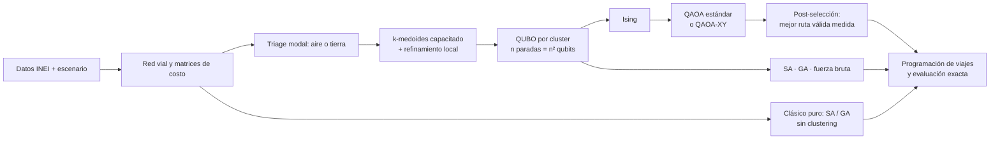

# Q-Rutas Piura

Ruteo híbrido clásico-cuántico para llevar ayuda humanitaria a las comunidades que el desborde del río Piura deja aisladas durante un Fenómeno El Niño.

Es un prototipo de hackatón: un flujo completo que va de datos geográficos reales a rutas de helicóptero y camión, pasando por un modelo de optimización, su versión QUBO/Ising, un QAOA escrito en Qiskit y una comparación honesta contra métodos clásicos.


**En una línea:** 23 comunidades y 6 vehículos son 784 qubits si se plantea todo como un solo QUBO; la fase clásica lo baja a 7 subproblemas de 4 a 16 qubits; el QAOA encuentra la ruta óptima de los 7, y la solución híbrida queda a 2,8 % del mejor resultado clásico, sin ninguna ventana de medicinas incumplida. A este tamaño no hay ventaja cuántica, y el proyecto lo mide en vez de esconderlo.

---

## Cómo correrlo

```bash
pip install -r requirements.txt
python main.py              # corrida completa, ~1 minuto en una laptop
python main.py --rapido     # prueba corta para ver que todo funcione
python tests/verificar.py   # pruebas de consistencia del modelo
```

Todo lo que sale va a `resultados/`: siete figuras, `resumen.md` (tablas y lectura de los números), `rutas.csv` (cada parada con su hora de llegada), `metricas_globales.csv`, `metricas_subproblemas.csv` y `resultados.json`.

Opciones útiles:

| Opción | Qué hace |
|---|---|
| `--motor auto` (por defecto) | Entrena el QAOA con el simulador de statevector incluido (rápido y exacto) y, si Qiskit está instalado, muestrea el circuito final con Qiskit Aer y lo transpila a un backend falso de IBM para estimar recursos reales. |
| `--motor qiskit` | Además entrena con `qiskit.quantum_info.Statevector` en cada evaluación. Más lento, mismo resultado. |
| `--motor numpy` | No toca Qiskit. Sirve para correr en cualquier máquina. |
| `--semilla N` | Cambia la semilla de todos los métodos estocásticos. |

En Google Colab basta con subir la carpeta y abrir `notebooks/demo_hackaton.ipynb`; la primera celda instala Qiskit.

## Qué hay en el repo

```
qrutas_piura/
├── main.py                  punto de entrada
├── qrutas/
│   ├── config.py            todos los supuestos: flota, pesos, penalizaciones, hiperparámetros
│   ├── datos.py             carga de nodos, puentes, río y límites
│   ├── geo.py               distancias, proyección local, geometría
│   ├── red.py               red vial con río como barrera y puentes con estado
│   ├── costos.py            matrices de tiempo, combustible y riesgo; triage modal
│   ├── clustering.py        k-medoides capacitado (MILP) + refinamiento local
│   ├── qubo.py              QUBO del TSP por cluster, Ising, verificación exacta
│   ├── cuantico.py          QAOA estándar y QAOA-XY, simulador, traducción a Qiskit
│   ├── clasicos.py          fuerza bruta, SA, algoritmo genético, clásico puro sin clustering
│   ├── evaluacion.py        función objetivo exacta y programación de viajes
│   ├── hardware.py          recursos del circuito y tiempo estimado en QPU
│   ├── pipeline.py          orquestación
│   ├── visualizacion.py     mapas y gráficos
│   └── reporte.py           resultados/resumen.md
├── datos/                   CSV y GeoJSON del escenario (ver datos/LEEME_DATOS.md)
├── herramientas/preparar_datos.py   reproduce los datos desde las fuentes abiertas
├── tests/verificar.py
├── notebooks/demo_hackaton.ipynb
└── resultados/              salida de la última corrida
```

---

## 1. El escenario: qué es real y qué es supuesto

| Elemento | Origen |
|---|---|
| Coordenadas de las 23 comunidades | **Reales.** Padrón de centros poblados del INEI (vía `ubigeo-peru-aumentado`), con su código INEI en `datos/nodos.csv`. |
| Qué comunidades entran | **Reales.** Caseríos reportados como inundados o aislados en 2017 y 2023: Pedregal Grande y Chico, Narihualá, Viduque, Simbilá, La Legua, Santa Rosa, Cucungará, Chato Grande y Chico, Locuto, San Martín de Malingas, entre otros (fuentes al final). |
| Centros de acopio | **Reales.** Aeropuerto de Piura, desde donde salieron el puente aéreo de 2017 y los helicópteros de 2023 (Grupo Aéreo N.° 7), y el campus de la UDEP, centro de acopio de "Todos somos Piura" en 2017. |
| Márgenes del río | **Reales.** Simbilá, Catacaos y Cura Mori en la margen izquierda; La Arena, La Unión y El Tallán en la derecha (CENEPRED, RPP). |
| Puentes | **Existen**; su **estado es del escenario**: Cáceres restringido, Sánchez Cerro y Bolognesi cerrados por crecida, Grau operativo, Independencia (Catacaos–La Arena) colapsado. |
| Trazado del río y red vial | **Aproximados.** Corredores rectos entre puntos reales con un factor de sinuosidad; la trocha de desvío por la pampa es un supuesto. |
| Familias afectadas, demanda, ventanas de medicinas | **Escenario** (orden de magnitud). 10 kg por familia en la primera respuesta. |
| Flota | **Escenario.** 2 helicópteros tipo Mi-17 (4 t) en el aeropuerto, 2 camiones de 8 t en el aeropuerto y 2 en la UDEP. |


Todo lo que es escenario se cambia editando `datos/*.csv` o `qrutas/config.py`. Por ejemplo, poner el Puente Independencia en `operativo` en `datos/puentes.csv` y volver a correr muestra cuánto cuesta su caída.

---

## 2. Modelo matemático

### 2.1 Conjuntos y parámetros

- $\mathcal{D}$: centros de acopio. $\mathcal{C}$: comunidades. $V = \mathcal{D}\cup\mathcal{C}$.
- $\mathcal{K}$: vehículos; cada $k$ tiene tipo $m(k)\in\{\text{aéreo},\text{terrestre}\}$, base $d(k)\in\mathcal{D}$ y capacidad $Q_k$. Un vehículo puede hacer varios viajes $r\in\mathcal{R}_k$.
- $q_i$: demanda de la comunidad $i$ (kg). $b_i$: fin de la ventana para entregar medicinas (h).
- $s_m$: tiempo de descarga por parada; $\ell_m$: carga inicial; $\rho_m$: recarga entre viajes.
- $t^m_{ij}$, $f^m_{ij}$, $r^m_{ij}$: tiempo (h), combustible (L) y riesgo del mejor trayecto de $i$ a $j$ en el modo $m$.
- $a^m_{ij}\in\{0,1\}$: 1 si existe trayecto (un puente caído o un acceso anegado lo pone en 0).

**Costos por modo.** Para el camión, el trayecto es el camino de menor costo en la red vial $G=(N,E)$ sin los tramos bloqueados $E_B$. Cada tramo $e$ tiene largo $L_e$, tipo de vía y exposición al río $\varepsilon_e = e^{-d_e/1\,\text{km}}$ ($d_e$ = distancia al cauce):

$$t_e = \frac{L_e}{v_0\,\phi_{\text{vía}}\,(1-0.5\,\varepsilon_e)},\qquad f_e = 0.35\,L_e,\qquad r_e = r_0\,L_e\,\psi_{\text{vía}}\,(1+4\,\varepsilon_e)$$

Un puente restringido duplica el tiempo y suma 0,01 de riesgo. Para el helicóptero, $t = d_{\text{gc}}/v_h$, $f = 800\,t$ y $r = 0.004\,t + 0.0015$ por aterrizaje; no le afectan puentes ni anegamientos.

### 2.2 Variables

- $x^{kr}_{ij}\in\{0,1\}$: el viaje $r$ del vehículo $k$ va de $i$ a $j$.
- $y^{kr}_i\in\{0,1\}$: la comunidad $i$ se atiende en ese viaje.
- $\tau_i\ge 0$: hora de llegada a $i$. $S^{kr}\ge 0$: hora de salida del viaje.

### 2.3 Función objetivo

$$
\min\; J \;=\; \frac{w_T}{T_{\text{ref}}}\sum_{i\in\mathcal{C}}\tau_i
\;+\;\frac{w_F}{F_{\text{ref}}}\sum_{k,r}\sum_{(i,j)} f^{m(k)}_{ij}\,x^{kr}_{ij}
\;+\;\frac{w_R}{R_{\text{ref}}}\sum_{k,r}\sum_{(i,j)} r^{m(k)}_{ij}\,x^{kr}_{ij}
\;+\;\lambda\sum_{i\in\mathcal{C}}\max(0,\tau_i-b_i)
\;+\;M\sum_{k,r}\sum_{(i,j)}\big(1-a^{m(k)}_{ij}\big)\,x^{kr}_{ij}
$$

El primer término es el **tiempo total de entrega** (la suma de las horas de llegada: lo que espera la gente, no lo que dura el vehículo). Los pesos por defecto son $w_T=0.5$, $w_F=w_R=0.25$ con $T_{\text{ref}}=1$ h, $F_{\text{ref}}=100$ L, $R_{\text{ref}}=0.01$; $\lambda = 10$ por hora de atraso en medicinas y $M=10^4$ por arco sin ruta.

### 2.4 Restricciones

$$\sum_{k,r} y^{kr}_i = 1 \quad \forall i\in\mathcal{C}\qquad\text{(cada comunidad se atiende una vez)}$$

$$\sum_j x^{kr}_{ij} = \sum_j x^{kr}_{ji} = y^{kr}_i \quad \forall i,k,r \qquad\text{(flujo; cada viaje sale y vuelve a } d(k))$$

$$\sum_i q_i\,y^{kr}_i \le Q_k \quad \forall k,r\qquad\text{(capacidad)}$$

$$\tau_j \ge \tau_i + s_{m(k)} + t^{m(k)}_{ij} - M(1-x^{kr}_{ij}),\qquad \tau_j \ge S^{kr} + \ell_{m(k)} + t^{m(k)}_{d(k)j} - M(1-x^{kr}_{d(k)j})$$

(las dos últimas propagan el tiempo y eliminan subtours, al estilo MTZ), más $S^{k,r+1}\ge$ fin del viaje $r$ $+\,\rho_{m(k)}$ para los viajes múltiples. La ventana de medicinas $\tau_i\le b_i$ es blanda: se castiga con $\lambda$ y se reporta cuántas se incumplen. Las rutas bloqueadas tampoco se prohíben a la fuerza: cuestan $M$, que es como entran al QUBO.

Este es el modelo completo. Nadie lo resuelve tal cual aquí: es la referencia contra la que se evalúan **todas** las soluciones (`qrutas/evaluacion.py`).

---

## 3. Flujo híbrido



### 3.1 Fase clásica

1. **Preprocesamiento.** Proyección local en km, red vial con el río como barrera (ningún tramo lo cruza salvo por un puente, y se verifica al construir la red), caminos más cortos con Dijkstra y matrices $t, f, r, a$ por modo.
2. **Triage modal.** Si una comunidad no tiene ruta terrestre, va por aire. Si la tiene pero necesita medicinas y el camión no llegaría a tiempo ni yendo directo, también va por aire. En la corrida base pasa con Sinchao: el colapso del Puente Independencia obliga a ir por la trocha y el camión llegaría en 3,1 h con una ventana de 3 h.
3. **Clustering capacitado (reducción de dimensionalidad).** Por cada grupo (tipo de vehículo + depósito) se usa k-medoides donde la asignación a medoides es un problema entero exacto (`scipy.optimize.milp`) con capacidad del vehículo y **máximo 4 paradas**, porque 4 paradas son 16 qubits. La distancia es espacio-temporal, $d'(i,j) = c(i,j) + \kappa\,|u_i-u_j|\,\bar c$, para que las comunidades urgentes queden juntas y su viaje salga primero. Luego una búsqueda local mueve o intercambia comunidades entre clusters mientras baje el costo estimado con una ruta de vecino más cercano (barata; no resuelve el TSP, eso queda para el QAOA).
4. **Programación preliminar.** Con rutas de vecino más cercano se estima a qué hora sale cada viaje; esa hora entra al QUBO para las ventanas.


### 3.2 Formulación QUBO de cada cluster

Variables $x_{i,p}=1$ si la comunidad $i$ va en la posición $p$ ($p=0$ es la primera parada); con $n$ paradas son $n^2$ qubits. El truco que permite meter el tiempo total de entrega sin aproximar es reescribir la suma de llegadas posición por posición:

$$\sum_{p=0}^{n-1}\tau_p \;=\; n\,(t_0+\ell) + n\,t_{0,\pi_0} + \sum_{p=0}^{n-2}(n-1-p)\,\big(s + t_{\pi_p,\pi_{p+1}}\big)$$

Cada arco pesa tanto como el número de paradas que quedan por delante, y eso es cuadrático en $x$. La energía queda:

$$
E(\mathbf{x}) =
\sum_i c^{(0)}_i x_{i,0} + \sum_i c^{\text{ret}}_i x_{i,n-1}
+ \sum_{p=0}^{n-2}\sum_{i\ne j} c^{(p)}_{ij}\,x_{i,p}\,x_{j,p+1}
+ \sum_{p=0}^{n-2}\sum_i \tilde w_T (n-1-p)\,s\;x_{i,p}
+ \underbrace{\sum_i \pi_{i}\,x_{i,0} + \sum_{p\ge1}\sum_{j\ne i}\pi_{jip}\,x_{j,p-1}\,x_{i,p}}_{\text{ventanas de medicinas}}
+ A\Big[\sum_i\Big(1-\sum_p x_{i,p}\Big)^2 + \sum_p\Big(1-\sum_i x_{i,p}\Big)^2\Big]
$$

con $\tilde w_T = w_T/T_{\text{ref}}$ (análogo para $F$ y $R$) y

$$c^{(0)}_i = \tilde w_T\,n\,t_{0i} + \tilde w_F f_{0i} + \tilde w_R r_{0i} + M(1-a_{0i}),\qquad c^{\text{ret}}_i = \tilde w_F f_{i0} + \tilde w_R r_{i0} + M(1-a_{i0})$$

$$c^{(p)}_{ij} = \tilde w_T\,(n-1-p)\,t_{ij} + \tilde w_F f_{ij} + \tilde w_R r_{ij} + M(1-a_{ij})$$

- **Rutas bloqueadas:** el término $M(1-a_{ij})$ es la penalización por puente caído o acceso cortado.
- **Ventanas:** $\pi_{jip} = \lambda\max(0,\underline{\tau}_{jip}-b_i)$, donde $\underline{\tau}_{jip}$ es la llegada más temprana posible de $i$ en la posición $p$ si $j$ va justo antes. Para $p\le 1$ es exacta; en general es una cota inferior. Con $n\le3$ el QUBO reproduce el costo exacto de cada ruta (lo comprueba `tests/verificar.py`).
- **Penalización one-hot:** como todos los coeficientes de costo son $\ge 0$, cualquier estado inválido tiene energía $\ge A$. Basta $A > E_{\min}$ para que el mínimo global sea una ruta válida. Se usa $A = 1.25\,E(\text{ruta de vecino más cercano})$, que nunca es menor que $E_{\min}$.
- **Ising:** con $x = (1-z)/2$, $H_C = \sum_i h_i Z_i + \sum_{i<j} J_{ij} Z_i Z_j$ con $J_{ij} = Q_{ij}/4$ y $h_i = -Q_{ii}/2 - \sum_{j\ne i} Q_{ij}/4$.

### 3.3 Fase cuántica: QAOA

$$|\boldsymbol\gamma,\boldsymbol\beta\rangle = \prod_{l=1}^{p} e^{-i\beta_l H_M}\,e^{-i\gamma_l H_C}\,|\psi_0\rangle$$

**QAOA estándar** (Farhi et al.): $|\psi_0\rangle = |+\rangle^{\otimes n^2}$, $H_M = \sum_q X_q$. La capa de costo son compuertas $R_Z(2\gamma h_i)$ y $R_{ZZ}(2\gamma J_{ij})$; el mezclador, $R_X(2\beta)$ en cada qubit.

**QAOA-XY**, o Quantum Alternating Operator Ansatz (Hadfield et al.): el estado inicial es una ruta válida elegida al azar y el mezclador intercambia dos comunidades $u,v$ entre posiciones consecutivas:

$$H^{(p)}_{uv} = |1100\rangle\langle 0011| + \text{h.c.} \quad\text{sobre } (x_{u,p},\,x_{v,p+1},\,x_{u,p+1},\,x_{v,p}) \;=\; \tfrac18\big(XXXX - YYXX - XXYY + YXYX + YXXY + XYYX + XYXY + YYYY\big)$$

Los ocho términos conmutan, así que $e^{-i\beta H^{(p)}_{uv}}$ se implementa exacto con rotaciones de Pauli (cambio de base, escalera de CNOT y un $R_Z$). El estado nunca sale del espacio de rutas válidas, por lo que la capa de costo no necesita penalizaciones.

**Entrenamiento.** Se minimiza la CVaR al 15 % (Barkoutsos et al.): el promedio del 15 % de energías más bajas, que empuja a concentrar probabilidad en buenas rutas en vez de bajar un promedio dominado por estados malos. Rejilla de $16\times16$ en $p=1$, refinamiento con COBYLA y crecimiento capa por capa hasta $p=3$ con la inicialización INTERP (Zhou et al.).

**Lectura.** Se miden 4096 disparos y se toma la ruta válida de menor energía entre las medidas (post-selección).

**Qiskit.** Los circuitos se describen en una representación intermedia mínima que `ir_a_qiskit()` traduce 1 a 1 a un `QuantumCircuit` (compuertas `h, x, s, sdg, cx, rz, rx, rzz`). Para entrenar rápido se usa un simulador de statevector propio que aplica la capa de costo como fase diagonal; `tests/verificar.py` comprueba que da exactamente el mismo estado que el circuito compuerta por compuerta y, si Qiskit está instalado, que el statevector de Qiskit coincide. Con `qiskit-ibm-runtime` instalado, el circuito final se transpila a un backend falso de IBM (topología heavy-hex) para contar compuertas reales.

### 3.4 Métodos clásicos de comparación

- **Sobre el mismo QUBO:** Simulated Annealing con volteo de un bit (64 lecturas, 300 barridos), algoritmo genético sobre permutaciones (cruce OX, mutación por intercambio) y fuerza bruta como referencia exacta.
- **Clásico puro, sin clustering:** SA y GA sobre el problema completo de cada grupo con representación de "tour gigante" con separadores, de modo que el método decide a la vez cómo partir las comunidades en viajes y en qué orden visitarlas, sin límite de paradas. Se evalúa con la misma función exacta.

---

## 4. Métricas

| Métrica | Qué significa |
|---|---|
| $J$ | Función objetivo completa (sección 2.3). Menor es mejor. |
| Brecha | $100\,(E - E_{\text{opt}})/|E_{\text{opt}}|$ respecto al óptimo del QUBO (fuerza bruta). |
| P(opt) | Probabilidad de obtener la ruta óptima en un disparo (QAOA) o en una lectura (SA). |
| P(fact) | Probabilidad de medir una ruta válida. |
| TTS | Disparos o lecturas necesarios para ver el óptimo una vez con 99 % de confianza: $\lceil \ln 0.01/\ln(1-P_{\text{opt}})\rceil$. |
| Evaluaciones | Llamadas a la función objetivo hasta converger. Una del QAOA es ejecutar el circuito completo con miles de disparos. |
| Tiempo en QPU (estimado) | $N_{\text{eval}}\times[\text{disparos}\times(\text{duración del circuito} + 250\,\mu\text{s}) + \text{latencia}]$. |
| Prob. de disparo sin error | $(1-\epsilon_{2q})^{N_{2q}}(1-\epsilon_{1q})^{N_{1q}}(1-\epsilon_m)^{n}$ con tasas de error típicas actuales. |

---

## 5. Resultados de la corrida incluida

(semilla 2026; el detalle completo está en `resultados/resumen.md`)

| Método | J | Entrega acumulada (h) | Combustible (L) | Ventanas incumplidas | Cómputo |
|---|---|---|---|---|---|
| Clásico puro: SA sin clustering | **35.05** | 50.3 | 932 | 0 | 0,8 s |
| Clásico puro: GA sin clustering | 35.24 | 50.4 | 979 | 0 | 1,0 s |
| Clustering + fuerza bruta | 36.02 | 52.2 | 936 | 0 | 0,2 s |
| Híbrido: clustering + QAOA | 36.02 | 52.2 | 936 | 0 | 34 s (simulado) |
| Híbrido: clustering + QAOA-XY | 36.02 | 52.2 | 936 | 0 | 5 s (simulado) |

| Subproblema | Qubits | P(opt) QAOA | P(opt) QAOA-XY | P(opt) SA | Brecha QAOA |
|---|---|---|---|---|---|
| Aéreo-1 | 9 | 0.066 | 0.382 | 0.75 | 0 % |
| Aéreo-2 | 16 | 0.0035 | 0.166 | 0.26 | 0 % |
| Aéreo-3 | 16 | 0.0019 | 0.192 | 0.32 | 0 % |
| Terr-A1 | 9 | 0.027 | 0.241 | 0.85 | 0 % |
| Terr-A2 | 4 | 0.171 | 0.623 | 0.99 | 0 % |
| Terr-U1 | 9 | 0.045 | 0.185 | 0.90 | 0 % |
| Terr-U2 | 16 | 0.0022 | 0.153 | 0.24 | 0 % |


---

## 6. Lo que estos números dicen (y lo que no)

- **El QAOA sí resuelve los subproblemas, pero por post-selección.** En 16 qubits, el QAOA estándar pone 0,2-0,4 % de probabilidad en la ruta óptima; con 4096 disparos igual aparece varias veces. La mayor parte de su amplitud se va a bitstrings que ni siquiera son rutas (P(fact) entre 7 % y 41 %).
- **El mezclador importa más que la profundidad.** El QAOA-XY, que nunca sale del espacio de rutas válidas, sube P(opt) a 15-62 % con el mismo número de capas. El costo es un circuito mucho más profundo: hasta 2808 CNOT lógicos frente a 504.
- **No hay ventaja cuántica a esta escala.** SA sobre el mismo QUBO acierta en 24-99 % de sus lecturas y tarda decenas de milisegundos. El QAOA simulado tarda segundos y en un QPU real su entrenamiento se estima en 15-40 minutos por subproblema, casi todo latencia y disparos.
- **El ruido es el cuello de botella.** Con tasas de error actuales, un disparo del QAOA estándar de 16 qubits correría sin ningún error con probabilidad 1-4 %, y el QAOA-XY prácticamente nunca. Sin mitigación de errores, los resultados en hardware serían mucho peores que en simulación.
- **La descomposición cuesta 2,8 %, no el QAOA.** Clustering + fuerza bruta da exactamente el mismo $J$ que el híbrido. La diferencia con el clásico puro viene de que este arma un vuelo de 5 paradas (Viduque, Narihualá, Pedregal Chico, Locuto, San Martín de Malingas) que en el híbrido no cabe: 5 paradas serían 25 qubits.
- **Lo que sí aporta el enfoque:** una formulación que crece de forma ordenada (el día que haya QPU con cientos de qubits buenos, el límite de 4 paradas se levanta en `config.py`), y una tubería completa y verificable donde el solver cuántico es una pieza intercambiable.

## 7. Próximos pasos

1. Reemplazar la red vial aproximada por OpenStreetMap (`osmnx.graph_from_place("Piura, Perú")`) manteniendo los atributos de arista de `red.py`, y el río por el cauce oficial de la ANA.
2. Correr el circuito final en hardware real de IBM Quantum con mitigación de errores (twirling, ZNE) y comparar con la estimación de `hardware.py`.
3. Probar warm-start QAOA y mezcladores XY de anillo, y formular el VRP por partición de conjuntos (selección de rutas candidatas), que necesita un qubit por ruta en vez de $n^2$.
4. Ciclo híbrido iterativo: reoptimizar la partición con la información de las rutas que devuelve el QAOA (búsqueda en vecindarios grandes con subrutina cuántica).
5. Demanda dinámica (reportes de COER cada pocas horas) y re-ruteo en línea.

## 8. Fuentes

- Coordenadas de centros poblados: INEI, vía [jmcastagnetto/ubigeo-peru-aumentado](https://github.com/jmcastagnetto/ubigeo-peru-aumentado) (MIT).
- Límites distritales: [juaneladio/peru-geojson](https://github.com/juaneladio/peru-geojson) (MPL-2.0).
- [Aeropuerto de Piura, coordenadas](https://en.wikipedia.org/wiki/PAF_Captain_Guillermo_Concha_Iberico_International_Airport) y [Universidad de Piura, coordenadas](https://en.wikipedia.org/wiki/University_of_Piura) (Wikipedia).
- [UDEP: centros de acopio de "Todos somos Piura" (2017)](https://www.udep.edu.pe/hoy/?p=67198) y [más de 60 toneladas distribuidas](https://www.udep.edu.pe/hoy/?p=67615).
- [Mongabay: caseríos más afectados del Bajo Piura (2017)](https://es.mongabay.com/2017/03/dia-despues-las-consecuencias-los-desbordes-e-inundaciones-del-rio-piura/) y [agua estancada en Pedregal, Narihualá, Monte Sullón y Viduque](https://es.mongabay.com/2017/04/emergencia-piura-balance-mes-funesto-norte-del-peru/).
- [RPP: cierre de puentes por la crecida y puntos vulnerables en Simbilá y Cura Mori](https://rpp.pe/peru/piura/video-la-crecida-del-rio-piura-obliga-a-las-autoridades-a-cerrar-los-puentes-de-la-ciudad-noticia-1039602).
- [CENEPRED: márgenes y áreas inundables del Bajo Piura](https://sigrid.cenepred.gob.pe/sigridv3/documento/2654/descargar).
- [Andina: ampliación del Puente Independencia (Catacaos–La Arena)](https://andina.pe/ingles/noticia-piura-mtc-inaugura-ampliacion-puente-independencia-catacaos-695596.aspx).
- [OSITRAN: Puentes Grau, km 992](https://www.ositran.gob.pe/anterior/wp-content/uploads/2025/04/acta-41-cru-piura-11-03-25.pdf).
- [El Tiempo: San Martín de Malingas aislado y un solo helicóptero de la FAP (2023)](https://eltiempo.pe/local/piura-existe-indolencia-del-estado-frente-al-dolor-de-piuranos-damnificados/).
- [Congreso: helicópteros desde el Grupo Aéreo N.° 7 (2023)](https://comunicaciones.congreso.gob.pe/noticias/congresista-miguel-ciccia-lleva-ayuda-a-damnificados-de-lluvias-torrenciales-en-piura) y [Andina: puente aéreo de la FAP (2017)](https://andina.pe/ingles/noticia-peru-air-force-provides-airlift-for-piura-chiclayo-and-trujillo-victims-658348.aspx).
- [RPP: desborde en Locuto, Tambo Grande (2017)](https://rpp.pe/peru/piura/video-la-crecida-del-rio-piura-obliga-a-las-autoridades-a-cerrar-los-puentes-de-la-ciudad-noticia-1039602).

Referencias técnicas: Farhi, Goldstone y Gutmann (2014), *A Quantum Approximate Optimization Algorithm*; Hadfield et al. (2019), *From the QAOA to a Quantum Alternating Operator Ansatz*; Barkoutsos et al. (2020), *Improving Variational Quantum Optimization using CVaR*; Zhou et al. (2020), *Quantum Approximate Optimization Algorithm: Performance, Mechanism, and Implementation on Near-Term Devices*; Lucas (2014), *Ising formulations of many NP problems*.
